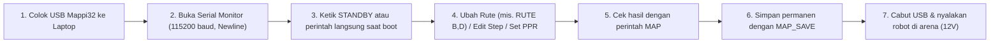

# Panduan Lengkap Mengubah Mapping Rute AGV (Tanpa LoRa / via Serial Monitor)

> **Ringkasan 30 Detik:**  
> Saat modul radio **LoRa belum terpasang**, Anda bisa mengubah rute tujuan, mengedit belokan/jarak langkah demi langkah, dan menyetel kalibrasi encoder langsung lewat **Serial Monitor (`115200 baud`)** di Arduino IDE.  
> Setelah disimpan dengan perintah **`MAP_SAVE`**, mapping tersimpan **permanen di memori Flash ESP32 (NVS)** — kabel USB boleh dicabut, dan saat robot dinyalakan dengan baterai 12V di arena, robot langsung menjalankan mapping terbaru tersebut.

---

## Daftar Isi

1. [Alur Singkat Mengubah Mapping di Lapangan](#1-alur-singkat-mengubah-mapping-di-lapangan)
2. [Peta Arena 3 m × 3 m, Kode Stasiun, & Kode Simpang](#2-peta-arena-3-m--3-m-kode-stasiun--kode-simpang)
3. [Cara 1 — Ubah Rute Stasiun Otomatis (`RUTE`, `RUTE_ONEWAY`, `CMD:GO`)](#3-cara-1--ubah-rute-stasiun-otomatis)
4. [Cara 2 — Edit Mapping Manual Step-by-Step (`MAP_ADD`, `MAP_SET`, `MAP_DEL`)](#4-cara-2--edit-mapping-manual-step-by-step)
5. [Cara 3 — Kalibrasi Live Tanpa Upload Ulang (`SET_PPR`, `SET_JEDA`, `SET_AUTOSTART`)](#5-cara-3--kalibrasi-live-tanpa-upload-ulang)
6. [Menyimpan Permanen & Reset ke Bawaan (`MAP_SAVE`, `MAP_LOAD`, `MAP_DEFAULT`)](#6-menyimpan-permanen--reset-ke-bawaan)
7. [Cara 4 — Mengubah Mapping Default di Kode Sumber (Untuk Git)](#7-cara-4--mengubah-mapping-default-di-kode-sumber)
8. [Kesiapan Integrasi LoRa Nanti](#8-kesiapan-integrasi-lora-nanti)
9. [Cheat Sheet Semua Perintah Serial Monitor](#9-cheat-sheet-semua-perintah-serial-monitor)

---

## 1. Alur Singkat Mengubah Mapping di Lapangan



> [!TIP]
> **Supaya robot tidak keburu jalan di meja saat baru dicolok USB:**
> Saat Mappi32 dinyalakan/reset, robot memberi jeda **2 detik** sebelum mulai berjalan (jika `AUTOSTART = ON`). Selama 2 detik itu, langsung kirim perintah apa saja (misal `STANDBY` atau `MAP`), maka auto-start otomatis **batal** dan robot masuk mode konfigurasi dengan motor diam.  
> Bila ingin robot selalu diam menunggu perintah `START`, atur sekali saja lewat `SET_AUTOSTART 0` lalu `MAP_SAVE`.

---

## 2. Peta Arena 3 m × 3 m, Kode Stasiun, & Kode Simpang

Arena berukuran **3 meter × 3 meter** (tiap kotak grid berukuran ±100 cm × 100 cm, sedangkan simpang `N0` membagi sisi barat `N2–N3` masing-masing ±50 cm):

```text
[N1] ────────────────── [N5] ────────────────── [N9] ────────────────── [N13]
 │                       │                       │                       │
 │       BLOK A          │                       │       BLOK C          │
 │                       │                       │                       │
[N2] ───── [ A ] ────── [N6] ────────────────── [N10] ───── [ C ] ───── [N14]
 │                       │                       │                       │
 │                       │       BLOK B          │                       │
[N0] ◄════ (START)       │                       │                       │
 │                       │                       │                       │
[N3] ────────────────── [N7] ───── [ B ] ────── [N11] ────────────────── [N15]
 │                       │                       │                       │
 │       BLOK E          │                       │       BLOK D          │
 │                       │                       │                       │
[N4] ───── [ E ] ────── [N8] ────────────────── [N12] ───── [ D ] ───── [N16]
```

| Kode Stasiun | Letak Ruas | Jarak dari Simpang Terdekat |
| :---: | :--- | :--- |
| **`A`** | Tengah ruas `N2 ↔ N6` | `50 cm` di timur `N2` / `50 cm` di barat `N6` |
| **`B`** | Tengah ruas `N7 ↔ N11` | `50 cm` di timur `N7` / `50 cm` di barat `N11` |
| **`C`** | Tengah ruas `N10 ↔ N14` | `50 cm` di timur `N10` / `50 cm` di barat `N14` |
| **`D`** | Tengah ruas `N12 ↔ N16` | `50 cm` di timur `N12` / `50 cm` di barat `N16` |
| **`E`** | Tengah ruas `N4 ↔ N8` | `50 cm` di timur `N4` / `50 cm` di barat `N8` |

---

## 3. Cara 1 — Ubah Rute Stasiun Otomatis

Modul [mobil_code/GridGraph.h](mobil_code/GridGraph.h) memodelkan seluruh 23 titik arena (`START`, `N0`–`N16`, `A`–`E`) dengan algoritma jalur terpendek **Dijkstra**. Anda cukup menuliskan daftar huruf stasiun yang ingin dikunjungi (maksimal 5 stasiun per misi):

| Perintah di Serial Monitor | Efek & Perilaku Robot |
| :--- | :--- |
| `RUTE A,C` | Susun rute **Pulang-Pergi (PP)**: `START → A (jeda 3s) → C (jeda 3s) → U-Turn → pulang START`. Robot masuk `STANDBY` agar Anda bisa cek `MAP` & `MAP_SAVE`. |
| `RUTE B` | Susun rute **PP**: `START → N0 (kanan) → N3 (kiri) → N7 → B (jeda 3s) → U-Turn → pulang START`. |
| `RUTE E,D` | Susun rute **PP**: `START → E (jeda 3s) → D (jeda 3s) → U-Turn → pulang START`. |
| `RUTE A,B,D` | Susun rute **PP** mengunjungi 3 stasiun berurutan: `A → B → D → START`. |
| `RUTE_ONEWAY A,C` | Susun rute **searah** (`START → A → C`), lalu berhenti `STANDBY` di stasiun terakhir tanpa pulang. |
| `CMD:GO:A,C` | Susun rute **PP** dan **langsung jalan seketika** *(format kompatibel LoRa)*. |

### Contoh Praktik Mengganti Rute ke Stasiun `B` lalu `D`:

1. Buka Serial Monitor Arduino IDE (**`115200 baud`**, line ending **`Newline`** atau **`Both NL & CR`**).
2. Ketik perintah berikut satu per satu:
   ```text
   STANDBY
   RUTE B,D
   ```
3. Robot otomatis mencetak tabel mapping hasil susunan Graph Planner untuk dicek:
   ```text
   ================ [TABEL MAPPING RUTE AKTIF] ================
   Nama Rute   : RUTE_B_D_PP
   Jumlah Step : 12 / 28
   ...
   ```
4. Jika sudah sesuai, simpan permanen ke Flash ESP32:
   ```text
   MAP_SAVE
   ```
5. Untuk uji coba langsung saat masih terhubung USB, ketik `START`. Untuk uji mandiri di arena, cabut kabel USB dan nyalakan baterai 12V.

> [!NOTE]
> Jika ingin kembali persis ke mapping awal bawaan (`DEFAULT_A_C_PP`: hitung encoder utuh `50 cm` ke `A` dan `200 cm` ke `C`), jalankan `MAP_DEFAULT`.

---

## 4. Cara 2 — Edit Mapping Manual Step-by-Step

Mirip fitur **Plan Index** pada robot line follower lomba (seperti Ichibot), Anda bisa melihat, mengubah jarak/jeda pada satu baris tertentu, menghapus baris, atau menyusun rute custom sendiri dari nol.

### Melihat Tabel Mapping Aktif
Ketik **`MAP`** di Serial Monitor:
```text
Idx | Label               | Trig     | JarakCm | PauseMs | Aksi
----+---------------------+----------+---------+---------+-------
 0  | N0_BELOK_KIRI       | TKIRI    | -       | 80      | KIRI
 1  | N2_BELOK_KANAN      | CKANAN   | -       | 80      | KANAN
 2  | CHECKPOINT_A        | ENC      | 50.0    | 3000    | JEDA
 3  | CHECKPOINT_C        | ENC      | 200.0   | 3000    | JEDA
...
```

### Mengubah 1 Baris Step (`MAP_SET`)
Format:
```text
MAP_SET <IDX> <TRIG> <JARAK_CM> <PAUSE_MS> <AKSI>
```
Contoh — mengubah jarak berhenti Checkpoint `A` (indeks `2`) dari `50 cm` menjadi `45 cm` dengan jeda `4000 ms`:
```text
MAP_SET 2 ENC 45 4000 JEDA
MAP_SAVE
```

### Menyusun Rute Manual dari Nol (`MAP_CLEAR` + `MAP_ADD`)
Format:
```text
MAP_ADD <TRIG> <JARAK_CM> <PAUSE_MS> <AKSI>
```
Contoh — membuat lintasan uji sederhana: maju sampai simpang kiri → belok kiri → maju `60 cm` → berhenti `3 detik` → selesai:
```text
MAP_CLEAR
MAP_ADD TKIRI 0 80 KIRI
MAP_ADD ENC 60 3000 JEDA
MAP_ADD LANGSUNG 0 0 STOP
MAP
MAP_SAVE
```

### Menghapus 1 Baris Step (`MAP_DEL`)
```text
MAP_DEL <IDX>
```

### Kamus Kode `<TRIG>` dan `<AKSI>`

| Kode `<TRIG>` | Arti Kondisi Pemicu |
| :--- | :--- |
| `LANGSUNG` | Langsung jalankan aksi tanpa menunggu sensor (contoh: `UTURN` atau `STOP`) |
| `TKIRI` | Simpang T / belokan ke kiri (`[11111]` atau `S1 & S2 & S3` hitam) |
| `CKANAN` | Cabang siku ke kanan sementara garis lurus tetap ada (`S4 & S5` + `S3`) |
| `CKIRI` | Cabang siku ke kiri sementara garis lurus tetap ada (`S1 & S2` + `S3`) |
| `S4` | Simpang 4 / garis melintang penuh (`[11111]` atau kedua sayap `S1` & `S5` aktif) |
| `ENC` | Hitung jarak encoder roda kiri hingga mencapai `<JARAK_CM>` |

| Kode `<AKSI>` | Arti Aksi Robot |
| :--- | :--- |
| `KIRI` | Belok kiri 90° |
| `KIRI_P` | Belok kiri 90° torsi ekstra (khusus rute pulang) |
| `KANAN` | Belok kanan 90° |
| `LURUS` | Dorong lurus melintasi perempatan (`450 ms` + tunggu lepas garis) |
| `JEDA` | Berhenti diam selama `<PAUSE_MS>` ms lalu lanjut step berikutnya |
| `UTURN` | Maju sedikit lalu putar balik 180° |
| `STOP` | Parkir selesai misi & masuk `STANDBY` |

---

## 5. Cara 3 — Kalibrasi Live Tanpa Upload Ulang

Jika di lapangan berhenti encoder belum pas di tengah kotak merah `[A]` / `[C]`, Anda **tidak perlu upload ulang kode**:

1. **Ukur nilai PPR asli roda kiri:**
   Ketik `TEST_ENCODER`, lalu putar roda kiri **1 putaran penuh** atau dorong robot lurus **50 cm**. Lihat angka pulsa (`Quad` / `A` / `B`) yang tercetak.
2. **Ubah PPR di memori robot:**
   Misalnya saat diputar 1 kali penuh terbaca `220` pulsa, ketik:
   ```text
   SET_PPR 220
   ```
3. **Ubah lama jeda berhenti di stasiun** *(default `3000 ms` = 3 detik)*:
   ```text
   SET_JEDA 5000
   ```
4. **Ubah perilaku saat robot baru dinyalakan:**
   - `SET_AUTOSTART 1` → otomatis jalan 2 detik setelah dinyalakan (cocok untuk demo lapangan tanpa laptop).
   - `SET_AUTOSTART 0` → diam `STANDBY` saat dinyalakan, baru jalan setelah diketik `START`.
5. **Wajib simpan permanen:**
   ```text
   MAP_SAVE
   ```

---

## 6. Menyimpan Permanen & Reset ke Bawaan

Modul [mobil_code/RouteStorage.h](mobil_code/RouteStorage.h) menggunakan **`Preferences.h` (NVS Flash internal ESP32)** sehingga data tetap aman walaupun baterai dicabut atau board di-upload ulang selama partisi NVS tidak dihapus (*Erase All Flash*).

| Perintah | Fungsi |
| :--- | :--- |
| `MAP_SAVE` | Menyimpan tabel mapping aktif + `SET_PPR` + `SET_JEDA` + `SET_AUTOSTART` ke Flash ESP32. |
| `MAP_LOAD` | Membatalkan perubahan di RAM yang belum disimpan dan memuat ulang mapping terakhir dari Flash. |
| `MAP_DEFAULT` | Menghapus mapping custom di Flash dan mengembalikan ke preset bawaan pabrik (`DEFAULT_A_C_PP`). |

---

## 7. Cara 4 — Mengubah Mapping Default di Kode Sumber

Jika Anda ingin mengubah konfigurasi **bawaan awal** sebelum di-push ke Git agar anggota tim lain langsung mendapat default baru saat pertama kali upload:

1. **Ubah jarak, PPR, jeda, atau auto-start default** di [mobil_code/Config.h](mobil_code/Config.h#L154-L179):
   - `ENCODER_TICKS_PER_PUTARAN` (`330.0f`)
   - `JARAK_N2_KE_A_CM` (`50.0f`) dan `JARAK_A_KE_C_CM` (`200.0f`)
   - `DURASI_JEDA_TITIK_A_MS` / `DURASI_JEDA_TITIK_C_MS` (`3000`)
   - `AUTO_START_SAAT_NYALA` (`true`)
2. **Ubah urutan langkah preset default (`RUTE_DEFAULT_AC[]`)** di [mobil_code/RoutePlans.h](mobil_code/RoutePlans.h#L55-L67).
3. Jika sebelumnya pernah menjalankan `MAP_SAVE` di board fisik, setelah upload jalankan `MAP_DEFAULT` sekali di Serial Monitor agar isi Flash NVS ikut diperbarui ke default kode baru.

---

## 8. Kesiapan Integrasi LoRa Nanti

Seluruh fungsi pengatur rute dan eksekutor di [mobil_code/NavigationFSM.h](mobil_code/NavigationFSM.h) dipanggil melalui satu fungsi tunggal:
```cpp
prosesPerintah(cmd);
```
Nantinya, ketika modul radio **LoRa SX1276/RFM95** pada Mappi32 diaktifkan di [mobil_code/mobil_code.ino](mobil_code/mobil_code.ino), Anda cukup meneruskan string paket yang diterima LoRa ke `prosesPerintah(paketLoRa)`. Perintah berikut sudah langsung dikenali:
- `CMD:GO:A,C` / `CMD:GO:B,D` → susun rute otomatis PP dan langsung jalan.
- `CMD:STOP` → rem darurat (*E-Stop*).
- `CMD:HOME` → langsung putar balik pulang ke `START`.

---

## 9. Cheat Sheet Semua Perintah Serial Monitor

> **Pengaturan Serial Monitor:** Baudrate **`115200`**, Line Ending **`Newline`** (atau **`Both NL & CR`**).

| Perintah | Contoh | Fungsi Singkat |
| :--- | :--- | :--- |
| `HELP` | `HELP` | Tampilkan ringkasan perintah di Serial Monitor |
| `MAP` | `MAP` | Lihat tabel mapping rute & kalibrasi aktif |
| `RUTE <stasiun>` | `RUTE B,D` | Susun rute otomatis PP ke stasiun `A`–`E` (mode `STANDBY`) |
| `RUTE_ONEWAY <stasiun>` | `RUTE_ONEWAY A,C` | Susun rute searah berhenti di tujuan akhir |
| `CMD:GO:<stasiun>` | `CMD:GO:A,C` | Susun rute otomatis PP dan langsung jalankan |
| `MAP_CLEAR` | `MAP_CLEAR` | Kosongkan tabel mapping untuk isi manual |
| `MAP_ADD <T> <CM> <P> <A>` | `MAP_ADD ENC 50 3000 JEDA` | Tambah 1 step di akhir tabel |
| `MAP_SET <I> <T> <CM> <P> <A>` | `MAP_SET 2 ENC 45 3000 JEDA` | Ubah isi step ke-`I` |
| `MAP_DEL <I>` | `MAP_DEL 4` | Hapus step ke-`I` |
| `SET_PPR <nilai>` | `SET_PPR 220` | Ubah PPR encoder secara langsung |
| `SET_JEDA <ms>` | `SET_JEDA 4000` | Ubah lama jeda di semua checkpoint encoder |
| `SET_AUTOSTART <0\|1>` | `SET_AUTOSTART 0` | Matikan (`0`) / nyalakan (`1`) jalan otomatis saat boot |
| `MAP_SAVE` | `MAP_SAVE` | Simpan mapping & setting permanen ke Flash ESP32 |
| `MAP_LOAD` | `MAP_LOAD` | Muat ulang mapping tersimpan dari Flash ESP32 |
| `MAP_DEFAULT` | `MAP_DEFAULT` | Reset Flash ke rute default pabrik (`A,C PP`) |
| `START` | `START` | Jalankan misi dari step `0` |
| `LANJUT` | `LANJUT` | Lewati sisa waktu jeda 3 detik di stasiun |
| `PULANG` | `PULANG` | Langsung eksekusi U-Turn pulang ke `START` |
| `STANDBY` / `STOP` | `STANDBY` | Jeda sementara / rem darurat total |
| `STATUS` | `STATUS` | Cek status misi, step aktif, & jarak encoder real-time |
| `TEST_ENCODER` / `RESET_ENC` | `TEST_ENCODER` | Uji/kalibrasi sensor encoder roda kiri (5 detik) |
| `TEST_RODA` / `TEST_KANAN` | `TEST_RODA` | Uji putar motor 4 arah |
