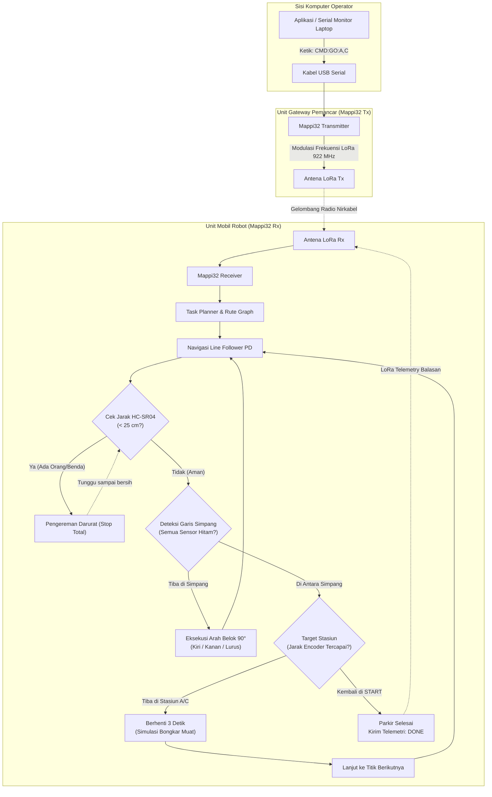

# DOKUMEN SPESIFIKASI & SKEMA SISTEM
## AGV (AUTOMATED GUIDED VEHICLE) GRID LINE FOLLOWER & KONTROL LORA
**Proyek:** Mobil Robot Pengantar Barang Otomatis (Smart Warehouse AGV)  
**Platform:** Mappi32 (ESP32-WROOM-32E) by KMtek + Modul LoRa 920–923 MHz  
**Lokasi File:** `SKEMA_AGV_ROBOT.md` (Root Directory)  
**Versi Dokumen:** 1.0.0  

---

## 1. Maksud & Inti Keinginan Klien (Executive Summary)

### A. Inti Konsep Klien
Klien menginginkan sistem **AGV (*Automated Guided Vehicle*) Cerdas Tanpa Pengemudi Manual**, seperti robot pembawa logistik di gudang modern Amazon atau fasilitas manufaktur industri:
1. **Bukan Remote Kontrol Manual:** Klien tidak ingin menggerakkan setir mobil (maju, belok kiri, belok kanan) satu per satu menggunakan joystick/keyboard.
2. **Kendali Berbasis Misi (*Mission Dispatch System*):** Operator di laptop/komputer cukup memilih tugas:
   > *"Kirim barang ke Stasiun A, lalu lanjut ke Stasiun C, setelah selesai kembali ke titik START."*
3. **Eksekusi Navigasi Mandiri:** Mobil menerima perintah lewat radio LoRa nirkabel jarak jauh, lalu menyusuri garis hitam secara mandiri, berbelok di persimpangan yang tepat, berhenti di stasiun tujuan untuk jeda muat/bongkar, lalu otomatis pulang ke parkiran awal (**START**).
4. **Sistem Keselamatan Radar Aktif:** Jika ada rintangan, manusia, atau kendaraan lain di jalur, sensor ultrasonik HC-SR04 otomatis menghentikan mobil sebelum terjadi tabrakan. Saat jalur bersih kembali, mobil otomatis melanjutkan misinya.

---

## 2. Bedah Peta Arena & Jalur Grid ($3\text{ m} \times 3\text{ m}$)

Berdasarkan gambar skema denah dari klien:
* Arena berukuran **$3\text{ Meter} \times 3\text{ Meter}$** dengan garis pandu berwarna hitam di atas lantai putih.
* Terdapat **17 Titik Simpang (Node $N_0$ s/d $N_{16}$)** sebagai titik pertemuan garis.
* Terdapat **5 Titik Stasiun Muat/Bongkar ($[A], [B], [C], [D], [E]$)** ditandai kotak merah di tengah ruas antar-Node.
* Titik **START** berada di sisi kiri luar yang terhubung langsung ke simpang **$N_0$**.

```
[N1] ────────────────── [N5] ────────────────── [N9] ────────────────── [N13]
 │                       │                       │                       │
 │      [ BLOK A ]       │                       │      [ BLOK C ]       │
 │                       │                       │                       │
[N2] ───── [ A ] ────── [N6] ────────────────── [N10] ───── [ C ] ───── [N14]
 │                       │                       │                       │
 │                       │      [ BLOK B ]       │                       │
[N0] <── (START)         │                       │                       │
 │                       │                       │                       │
[N3] ────────────────── [N7] ───── [ B ] ────── [N11] ────────────────── [N15]
 │                       │                       │                       │
 │      [ BLOK E ]       │                       │      [ BLOK D ]       │
 │                       │                       │                       │
[N4] ───── [ E ] ────── [N8] ────────────────── [N12] ───── [ D ] ───── [N16]
```

### Rincian Elemen Peta:
| Elemen | Kode Simbol | Letak Fisik | Metode Deteksi Robot |
| :--- | :---: | :--- | :--- |
| **Titik Awal** | `START` | Sisi barat luar sebelum $N_0$ | Posisi parkir mobil awal |
| **Node Masuk** | `N0` | Pertigaan pintu masuk | Sensor Garis 5ch mendeteksi garis melintang (`0 0 0 0 0`) |
| **Stasiun A** | `[A]` | Tengah ruas $N_2 - N_6$ | Pulsa Encoder Roda Kiri ($\pm 50\text{ cm}$ setelah $N_2$) |
| **Stasiun B** | `[B]` | Tengah ruas $N_7 - N_{11}$ | Pulsa Encoder Roda Kiri ($\pm 50\text{ cm}$ setelah $N_7$) |
| **Stasiun C** | `[C]` | Tengah ruas $N_{10} - N_{14}$| Pulsa Encoder Roda Kiri ($\pm 50\text{ cm}$ setelah $N_{10}$)|
| **Stasiun D** | `[D]` | Tengah ruas $N_{12} - N_{16}$| Pulsa Encoder Roda Kiri ($\pm 50\text{ cm}$ setelah $N_{12}$)|
| **Stasiun E** | `[E]` | Tengah ruas $N_4 - N_8$ | Pulsa Encoder Roda Kiri ($\pm 50\text{ cm}$ setelah $N_4$) |

---

## 3. Rute Skenario Misi Klien: START ➡️ A ➡️ C ➡️ START

Sesuai garis kuning pada gambar acuan klien, berikut urutan eksekusi gerak mobil:

```
[START] 
   ↓ (Maju masuk arena)
 [N0] ── Belok Kiri 90°
   ↓ (Menyusuri garis vertikal ke utara)
 [N2] ── Belok Kanan 90°
   ↓ (Menyusuri garis horizontal ke timur)
 [A]  ── BERHENTI (Jeda bongkar/muat 3 detik)
   ↓ (Lanjut maju lurus)
 [N6] ── Lurus terus (Melewati simpang perempatan)
   ↓ (Menyusuri garis horizontal ke timur)
 [N10] ── Lurus terus (Melewati simpang perempatan)
   ↓ (Menyusuri garis horizontal ke timur)
 [C]  ── BERHENTI (Jeda bongkar/muat 3 detik)
   ↓ (Misi selesai, eksekusi rute pulang)
 [N14] ── Putar Balik 180° (U-Turn)
   ↓ (Menyusuri garis horizontal ke barat)
 [N10] ── Lurus terus
   ↓
 [N6] ── Lurus terus
   ↓
 [N2] ── Belok Kiri 90° (Menuju selatan)
   ↓
 [N0] ── Belok Kanan 90° (Keluar arena)
   ↓
[START] ── PARKIR SELESAI
```

---

## 4. Arsitektur Perangkat Keras & Konfigurasi Pin (Mappi32)

Kedua unit menggunakan board **Mappi32** (ESP32 by KMtek) dengan chip LoRa internal RFM95/SX1276.

> [!IMPORTANT]
> **Proteksi Pin LoRa Internal:**  
> Board Mappi32 menggunakan pin internal SPI untuk LoRa: `IO14 (SCK)`, `IO13 (MOSI)`, `IO12 (MISO)`, `IO15 (NSS)`, `IO0 (RST)`, `IO27 (DIO0)`.  
> Pin-pin ini **DILARANG KERAS** disambungkan ke motor atau sensor eksternal agar radio LoRa dapat memancarkan dan menerima sinyal dengan stabil!

### Tabel Pengkabelan Lengkap Unit Mobil (AGV Receiver):

| Komponen | Pin Modul | Terhubung ke Pin Mappi32 | Keterangan / Fungsi |
| :--- | :--- | :--- | :--- |
| **LoRa (Internal)** | SCK, MOSI, MISO | `GPIO 14, 13, 12` | SPI Bus Hardware Internal |
| | NSS / CS, RST, DIO0 | `GPIO 15, 0, 27` | Kontrol & Interrupt Radio LoRa |
| **Driver Motor Kiri** | IN1 (Maju Kiri) | `GPIO 25` | Output PWM kendali motor kiri maju |
| | IN2 (Mundur Kiri) | `GPIO 26` | Output PWM kendali motor kiri mundur |
| **Driver Motor Kanan**| IN3 (Maju Kanan) | `GPIO 16` *(Soldered)* | Output PWM kendali motor kanan maju |
| | IN4 (Mundur Kanan) | `GPIO 17` *(Soldered)* | Output PWM kendali motor kanan mundur |
| **Sensor Garis 5ch** | Sensor 1 (Paling Kiri)| `GPIO 34` (Input Only) | `0 = Hitam`, `1 = Putih` |
| | Sensor 2 (Kiri) | `GPIO 35` (Input Only) | `0 = Hitam`, `1 = Putih` |
| | Sensor 3 (Tengah) | `GPIO 36` (Input Only / SENSOR_VP)| `0 = Hitam`, `1 = Putih` |
| | Sensor 4 (Kanan) | `GPIO 39` (Input Only / SENSOR_VN)| `0 = Hitam`, `1 = Putih` |
| | Sensor 5 (Paling Kanan)| `GPIO 23` | `0 = Hitam`, `1 = Putih` |
| **Encoder Motor Kiri**| Output Fase A | `GPIO 32` | Interrupt counter pulsa jarak |
| | Output Fase B | `GPIO 33` | Deteksi arah putaran |
| **Ultrasonik HC-SR04**| Trigger Pin | `GPIO 19` | Output pemicu pulsa sonik 10 µs |
| | Echo Pin | `GPIO 18` | Input pembacaan waktu pantul |

---

## 5. Diagram Blok Alur Kerja Sistem (Workflow Mermaid)



---

## 6. Protokol Komunikasi LoRa (Format Data Ringan)

Menggunakan format string berbasis teks ASCII sederhana, tahan gangguan (*robust*), dan berkecepatan tinggi:

### A. Perintah dari Laptop ke Mobil:
| Sintaks Pesan | Contoh | Arti Perintah |
| :--- | :--- | :--- |
| `CMD:GO:<STASIUN1>,<STASIUN2>` | `CMD:GO:A,C` | Jalankan misi dari START menuju Stasiun A, lanjut ke C, lalu pulang |
| `CMD:STOP` | `CMD:STOP` | Berhenti darurat (*Emergency E-Stop*) seketika |
| `CMD:HOME` | `CMD:HOME` | Batal misi dan langsung pulang ke titik START terdekat |

### B. Laporan Status dari Mobil ke Laptop (Telemetri Real-time):
| Pesan Balasan | Makna Kondisi Robot |
| :--- | :--- |
| `STAT:ACK:A,C` | Perintah misi diterima dan diverifikasi valid |
| `STAT:NAVIGATING:N2` | Robot sedang melintasi Node $N_2$ |
| `STAT:ARRIVED:A` | Robot telah sampai di Stasiun A, sedang proses muat |
| `STAT:ARRIVED:C` | Robot telah sampai di Stasiun C, sedang proses bongkar |
| `STAT:OBSTACLE_DETECTED` | Robot terhenti sementara karena ada halangan di depan |
| `STAT:OBSTACLE_CLEARED` | Jalur kembali bersih, robot melanjutkan jalan |
| `STAT:COMPLETED:AT_START` | Misi sukses 100%, robot telah parkir di START |

---

## 7. Rencana Tahapan Pengembangan (Roadmap)

1. **Tahap 1 — Fondasi & Kalibrasi Pergerakan (Selesai):**
   * Verifikasi pembacaan Sensor Garis TCRT5000 (Garis = `0`, Lantai = `1`).
   * Tuning PID Line Follower kurva halus dan trim gerak lurus (`TRIM_KIRI = 23, TRIM_KANAN = -9`).
   * Verifikasi keamanan radar ultrasonik anti-tabrak HC-SR04 dengan jeda 60 ms dan proteksi blind spot.
2. **Tahap 2 — Algoritma Deteksi Node & Belok Poros 90° (Berikutnya):**
   * Pembuatan logika pengenal simpang $N_0, N_1, \dots$ saat sensor mendeteksi garis melintang.
   * Fungsi belok poros tepat 90 derajat (*differential pivot turn*) berbasis penguncian garis kembali.
3. **Tahap 3 — Integrasi Encoder untuk Jarak Stasiun:**
   * Kalibrasi rasio pulsa encoder per centimeter gerak roda.
   * Logika pengereman tepat di titik stasiun $[A], [B], [C], [D], [E]$.
4. **Tahap 4 — Firmware Komunikasi LoRa Mappi32:**
   * Pembuatan kode Transmitter untuk Mappi32 pengirim (terhubung ke USB Laptop).
   * Integrasi pustaka LoRa pada Mappi32 robot untuk menerima string instruksi misi.
5. **Tahap 5 — Integrasi Penuh & Uji Coba Lapangan:**
   * Pengujian rute lengkap `START ➔ A ➔ C ➔ START` di atas arena $3\text{m} \times 3\text{m}$.
